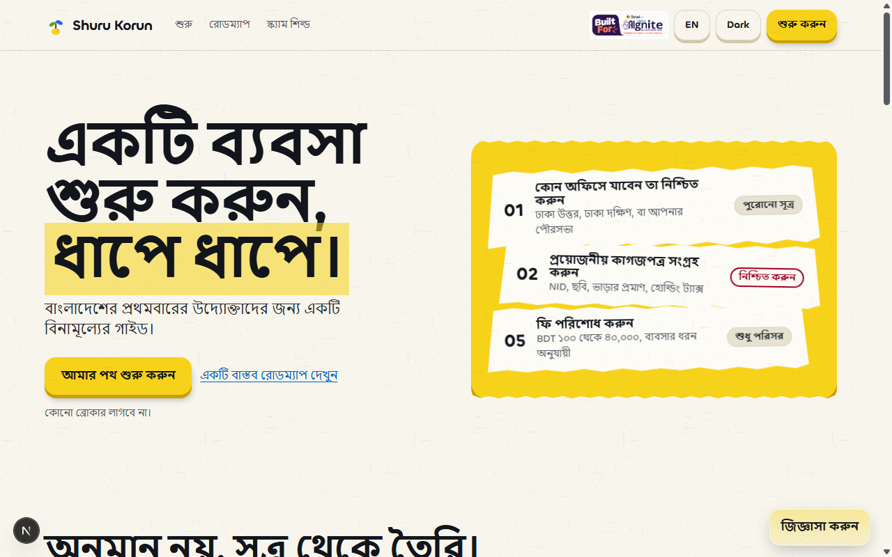
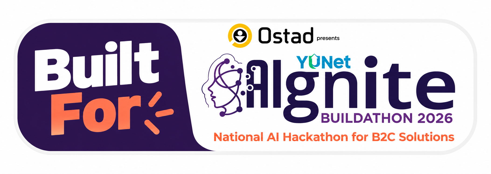
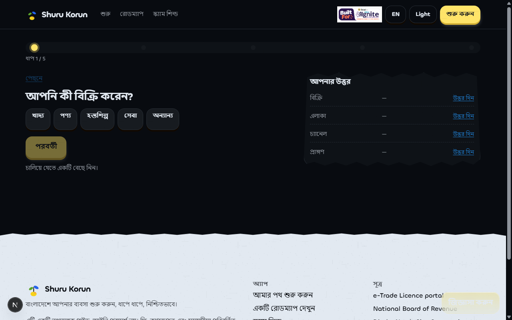
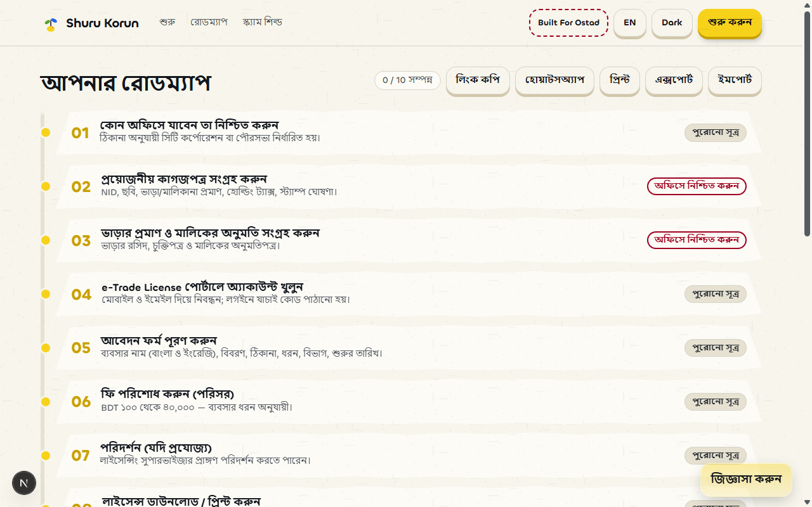
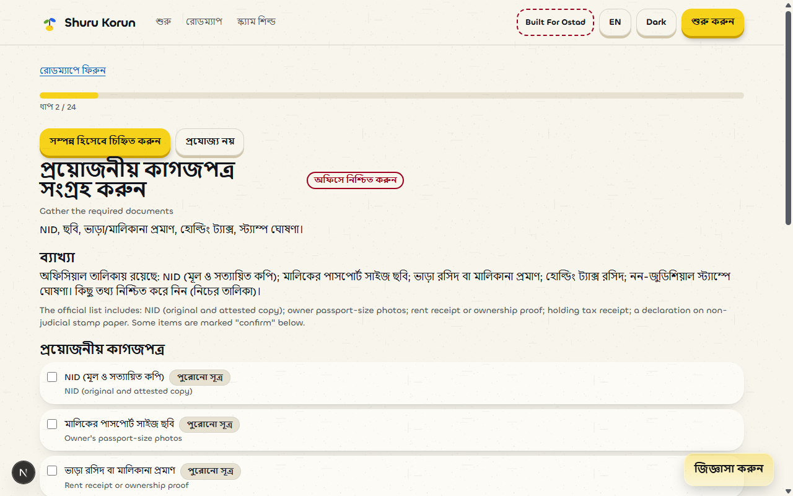
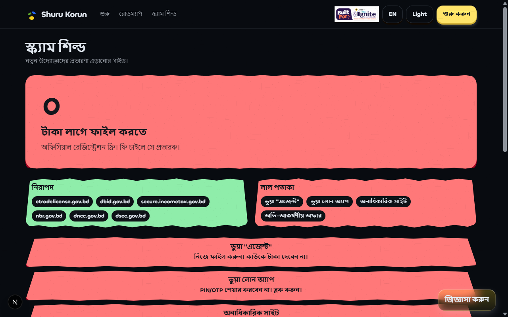
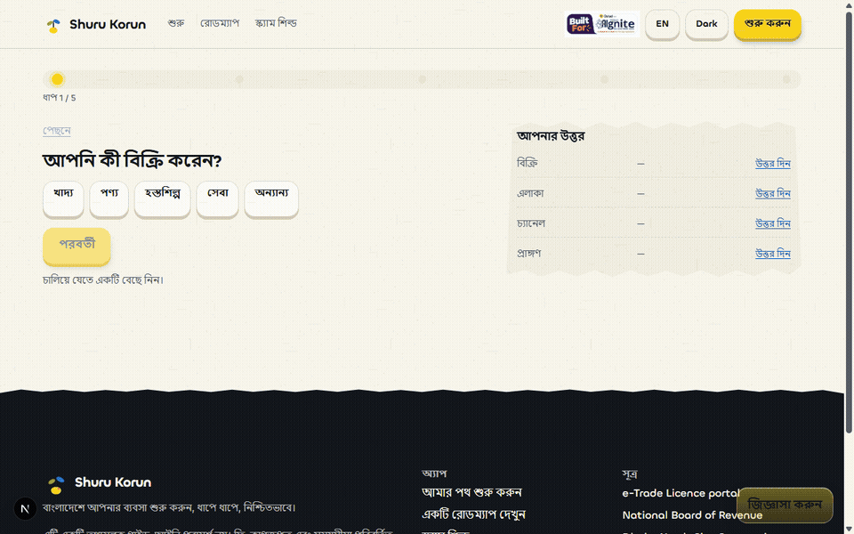
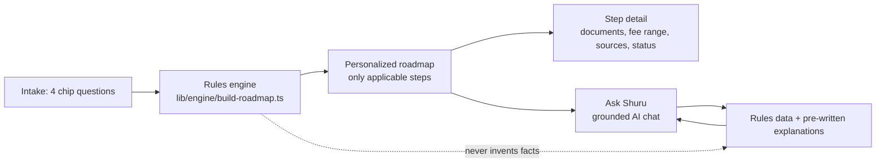

# Shuru Korun (শুরু করুন)

> শুরু করুন — Start your business, step by step.

[](https://nextjs.org)
[](https://www.typescriptlang.org)
[](#testing)
[](https://shuru-korun.vercel.app)
[](#)



A free, mobile-first web app that tells a first-time founder in Bangladesh what to do, in what order, to start a small business. It covers the documents, the offices, the fees (as ranges), the timelines, and the sources, in Bangla, English, or Banglish, and warns about scams and common mistakes.

<p align="center">
  
</p>

**Live app:** [shuru-korun.vercel.app](https://shuru-korun.vercel.app) · **No account required.**

---

## Why this matters

First-time founders in Bangladesh — home bakers, Facebook sellers, small shop owners, freelancers — rarely know which office to visit, which documents to bring, or which "agent" is a scam. Official information is scattered across portals and PDFs, often in English, and fees are quoted as single figures by unofficial calculator sites. Shuru Korun turns that into a personal, sourced, step-by-step roadmap that works on a cheap Android phone with weak data. It is an information guide, not legal advice: every fact carries a status, a source, and a last-checked date.

---

## What it does

1. **Personal roadmap in under five minutes.** Four chip-based intake questions (what you sell, where, how you sell, rented/owned/family premises) build a roadmap that contains only the steps that apply to you.
2. **Two paths, one roadmap.** Trade license (Path A, for physical or home-based selling) and DBID (Path B, for online or Facebook selling). Online food selling sets the DBID business type to "Food Aggregator" and adds a food-rules check.
3. **Every fact is sourced.** Each step shows a verification label (Verified, Dated source, or Confirm at office), the source name, and a last-checked date. No fee amount appears that is not in the verified range.
4. **AI that adds value, never invents.** Ask Shuru answers only from the rules data and pre-written explanations, shows the sources it used, and says "I don't know: confirm at your city corporation office" when the data does not cover the question.
5. **Scam shield.** Common scams (fake agents, fake loan apps, mobile-money phishing), official links only, and a "check a link or number" tool.
6. **Progress that survives a reload.** Steps are marked done in `localStorage`. No account, no server storage.
7. **Reminders.** Key dates shown on the progress screen (works while the app is open).
8. **Dark mode and reduced motion.** Light by default, manual toggle persisted; respects `prefers-reduced-motion`.

---

## Screenshots

| Landing | Intake (chips) |
|---|---|
|  |  |

| Roadmap | Step detail |
|---|---|
|  |  |

| Scam shield | Ask Shuru |
|---|---|
|  |  |

### Intake flow (5 s)



---

## How it works



The AI never decides which steps apply. The rules engine reads only the rules data in `lib/rules/*`; the AI is grounded in that data plus pre-written explanations, and says "I don't know" when the data does not cover the question.

---

## Stack

| Layer | Choice |
|---|---|
| Framework | Next.js 16 (App Router), TypeScript |
| Styling | Custom CSS: `app/globals.css`, `app/tokens.css`, `app/base.css` (Hallmark "Hum" theme: warm cream paper, torn edges, sprout logo). No Tailwind. |
| Fonts | Chillax (display, via Fontshare); Noto Sans Bengali (body, via `next/font`) |
| Motion | CSS animations only (peel-in, grow-progress, sticker wobble) |
| i18n | `LocaleProvider` context plus `useLocale()`; per-screen bn/en dictionaries; persisted in `localStorage` (`sk.v1.lang`) |
| AI | Groq (primary, OpenAI-compatible SDK); Google Gemini (backup); pre-written fallback |
| Storage | Browser `localStorage` only |
| Tests | Vitest (rules engine and data invariants); Playwright Chromium for smoke checks |
| Hosting | Vercel Hobby |

---

## Getting started

```bash
pnpm install
cp .env.example .env.local   # set MOCK_AI=1 to run without API keys
pnpm dev                     # http://localhost:3000
```

<details>
<summary>Environment variables</summary>

| Variable | Required | Notes |
|---|---|---|
| `GROQ_API_KEY` | for live AI | Server-only. Never expose to the browser. |
| `GEMINI_API_KEY` | optional | Backup provider. |
| `GROQ_MODEL` | optional | Model name, set in config (default `openai/gpt-oss-20b`). |
| `GEMINI_MODEL` | optional | Model name, set in config. |
| `RATE_LIMIT_PER_MINUTE` | optional | Default 12 per visitor. |
| `MOCK_AI` | dev only | Set to `1` to run without API keys (returns pre-written text). |

Set all of these in Vercel project settings for preview and production. Never commit `.env` files.

</details>

## Scripts

```bash
pnpm dev     # development server
pnpm build   # production build
pnpm test    # vitest (rules engine branches and data invariants)
```

<details>
<summary>Project structure</summary>

```
shuru-korun/
  app/
    page.tsx               landing
    path/page.tsx          intake (4 chip questions)
    roadmap/page.tsx       personalized roadmap
    step/[id]/page.tsx     step detail
    scam-shield/page.tsx   scam shield and check-a-link tool
    api/ask/route.ts       AI endpoint (server)
    layout.tsx             navbar, footer, providers
    globals.css            all Hum styles and dark tokens
    tokens.css             design tokens
    base.css               base/reset layer
  components/
    ask/                   chat sheet with sources
    layout/                SiteHeader, SiteFooter
    providers/             LocaleProvider
    reminders/             F10 reminders
    roadmap/               StepActions, ProgressSummary
    ui/                    BackToTop, LanguageToggle, ThemeToggle, liquid-glass FAB
    pwa/                   service worker registration
  lib/
    rules/                 types, trade-license (Path A), dbid (Path B), sources
    engine/                build-roadmap and tests
    ai/                    provider, prompt, cache, rate-limit, guard, retrieve
    config/                feature flags
    progress/              localStorage wrapper
  public/                  logo, favicon, liquid-glass module, manifest, sw
  logo/                    brand kit (concepts, lockups, guidelines)
  screenshots/             README images
```

</details>

---

## AI behavior

- **Providers:** Groq (primary) → Google Gemini (backup) → pre-written explanation.
- **Grounding:** each request includes only the rules data relevant to the step or question, plus the pre-written explanation. The system instruction forbids inventing fees, documents, or deadlines, and requires citing status and date.
- **Privacy:** the AI never receives NID numbers, dates of birth, names, addresses, phone numbers, passwords, or photos. Intake answers are sent only as categories (for example, "sells food online, Dhaka North, rented").
- **Limits:** replies target under 150 words; answers are cached per question; the endpoint is rate-limited per visitor (default 12/min).
- **Disclaimer:** shown above every answer: "Shuru Korun is not legal advice. Confirm at your city corporation office."

## Privacy and data

- No accounts, no logins, no personal data stored on our servers.
- `localStorage` is used only for progress, reminders, language, and theme.
- No third-party analytics in the first version.
- The app states clearly that users should not type NIDs, passwords, or OTPs into the chat.

## Testing

```bash
pnpm test   # vitest: rules engine branches and data invariants (28 tests)
pnpm build  # production build
```

Rules data tests fail if any step lacks a source, a date, or a status, or if an unverified fee amount appears.

## Deploy

1. Push to `main`; Vercel builds a production deployment.
2. Set environment variables in Vercel (production and preview).
3. Check the build log for errors.
4. Open the public link on a phone and run the smoke test: intake, roadmap, one step, Ask Shuru, scam shield.
5. Keep the last working version available; roll back in Vercel if a new deploy breaks.

## How facts are verified

Every statement in the app comes from `lib/rules/*`. Each step carries a `status` (`verified`, `dated`, or `confirm`), a list of source ids, and a `lastChecked` date. The rules engine in `lib/engine/build-roadmap.ts` is pure: it reads only this data and never invents steps. The AI is grounded in the same data and is forbidden from inventing fees, documents, or deadlines. The rules data tests fail if any step lacks a source, a date, or a status, or if an unverified fee amount appears.

## Disclaimers

- Footer and Ask Shuru: "Shuru Korun is an information guide, not legal advice. Fees, documents, and timelines change. Confirm at your city corporation office or on the official portal."
- Each step: "Last checked: [date]. Source: [name]."
- Scam shield: "Official registration is free. Never share your PIN or OTP with anyone."
- Every "confirm at office" item is shown as open, never as fact.

## Open items

- Whether a home-based online seller needs a trade license as well as a DBID.
- Current trade license document list and fee schedule (verify on the portal).
- DBID full field list and whether any fee applies.
- Bangla OCR and Bangla speech recognition support on the target device (Tier 3, cut for now).

## License

Solo entry, one project only. All facts come from `lib/rules/*` with a status of `verified`, `dated`, or `confirm`. The AI never invents facts. Judging is on what is live when the round closes. Source code link is optional per the competition rules.